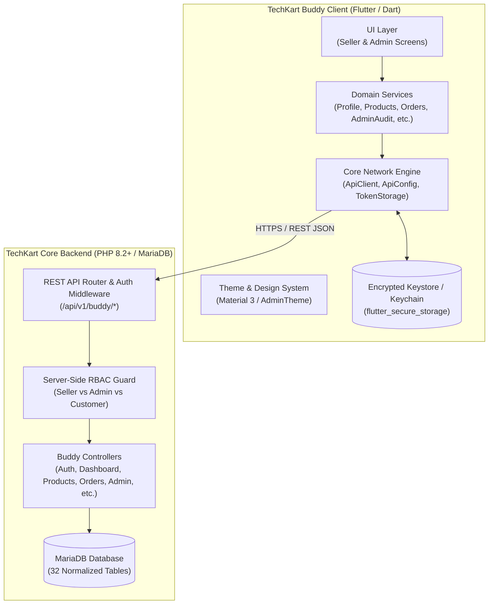

# TechKart Buddy 🛍️🚀
### Enterprise Merchant & Administrative Management Platform

[](https://flutter.dev)
[](https://dart.dev)
[]()
[]()
[]()
[]()
[-critical.svg)]()

---

## 📌 Overview

**TechKart Buddy** is the unified seller operations and marketplace administration application for the **TechKart eCommerce Ecosystem**. Built with high-performance Flutter/Dart and connected to the high-throughput TechKart REST API backend, it delivers a dual-portal mobile/desktop experience tailored for Indian e-commerce merchants and operations teams.

Whether an independent merchant managing product listings, tracking dispatched parcels, reviewing earnings, or an executive administrator managing platform-wide risk, seller KYC compliance, returns disputes, and catalog categories—TechKart Buddy streamlines operations with real-time telemetry, offline resilience, and strict multi-tenant isolation.

---

## 🌟 Key Pillars & Highlights

1. **Dual-Role Unified App Engine**: Single codebase hosting dedicated portals for **Verified Sellers** and **Platform Administrators**, switched dynamically upon authentication.
2. **End-to-End Indian Localization**: Native support for Indian Rupee (`₹ INR`), GSTIN registration, PAN verification, Aadhaar KYC workflows, +91 phone formats, Indian standard PIN codes, and states.
3. **Zero Hardcoded Data / Pure Empty-State Architecture**: Genuine empty states for new merchants; data loads dynamically from live REST endpoints with zero mock fallback leaks.
4. **Strict Multi-Tenant Isolation & Role Security**: Cryptographically signed JWT tokens with encrypted client storage (`flutter_secure_storage`), automatic session invalidation upon logout, and rigid server-side RBAC.
5. **Real-Time Operational Telemetry**: Live dispatch queues, inventory health gauges, stockout alerts, and financial settlement schedules.
6. **Zero-Secret Administration**: Platform administrators can audit, verify, suspend, and review merchant dossiers without exposing passwords or confidential API secrets.

---

## 🏗️ System Architecture



---

## 📱 Portals & Functional Modules

### 1. Merchant / Seller Portal
Tailored for Indian vendors to scale their business online:
- **Merchant Onboarding & KYC**: Seamless onboarding with Store Name, Category, GSTIN, PAN, Bank Details, and Document Uploads.
- **Dynamic Real-Time Dashboard**:
  - Live order counters: Placed, Processing, Ready to Ship, Shipped, Delivered.
  - Gross Revenue metrics & 7-day volume performance graph.
  - Real-time Dispatch Stream with instant status transitions.
- **Catalog & Product Authoring**:
  - Add / Edit products with multi-image support, title, rich description, HSN codes, MRP, selling price, and stock levels.
  - Automated low-stock threshold alerting (default 5 units).
- **Inventory Oversight**:
  - Quick stock updates, batch auditing, out-of-stock isolation, and archive/unpublish toggles.
- **Order Fulfillment & Logistics**:
  - Full order detail inspection, customer delivery address verification, tracking number binding, invoice generation, and status dispatch.
- **Financial Settlements & Earnings**:
  - Transparent settlement cycles (T+2 / T+3), GST deductions, platform commission breakdowns, payout references, and bank account attachments.
- **Returns & Customer Reviews**:
  - Quality inspection tracking, return approvals/rejections, and customer review moderation.

---

### 2. Platform Administration Portal
A command center designed for marketplace integrity, compliance, and governance:
- **Administrator Command Dashboard**:
  - Real-time marketplace KPIs: Active Sellers, Pending Applications, Published Listings, Pending Orders, Open Disputes, Total GMV.
  - System performance diagnostics: Server latency, core uptime, and escrow telemetry.
- **Seller Application Approval Queue (KYC Dossier)**:
  - Deep-dive into submitted business credentials (GSTIN, PAN, trade licenses).
  - One-click Approve, Reject, or Escalate with mandatory audit notes.
- **Merchant Directory & Customer Moderation**:
  - Comprehensive seller and buyer directory.
  - Instant account suspension, reactivation, and compliance flagging.
- **Marketplace Order & Returns Oversight**:
  - Platform-wide view of all transactions across all sellers.
  - Mediation and resolution for return requests and courier disputes.
- **Taxonomy & Category Management**:
  - Create, reorder, update, and manage global marketplace categories and subcategories.
- **System Audit Logs**:
  - Immutable timeline capturing all administrative actions, actor roles, targets, and JSON diff details.
- **Platform Security**:
  - Complete omission of sensitive customer/seller authentication credentials (`password_hash`, tokens) from all admin viewports.

---

## 📂 Project Directory Structure

```text
techkart_buddy/
├── asset/                        # App branding, category icons, subcategory assets
│   ├── categories/               # Indian marketplace category vector/raster assets
│   ├── subcategories/            # Taxonomy icons
│   └── techkart_buddy_logo.png   # High-resolution application launcher logo
├── lib/
│   ├── main.dart                 # Application bootstrap & MaterialApp configuration
│   ├── admin/                    # Administrative Management Module
│   │   ├── admin_audit_service.dart
│   │   ├── admin_auth_service.dart
│   │   ├── admin_bottom_nav.dart # Admin tab orchestrator
│   │   ├── admin_category_service.dart
│   │   ├── admin_customer_service.dart
│   │   ├── admin_dashboard.dart  # Platform overview & metrics command center
│   │   ├── admin_login.dart      # Administrative authentication with RBAC check
│   │   ├── admin_logout.dart
│   │   ├── admin_payment_service.dart
│   │   ├── admin_profile.dart
│   │   ├── admin_settings_service.dart
│   │   ├── admin_top_bar.dart
│   │   ├── audit_logs.dart       # Immutable action telemetry viewer
│   │   ├── category_management.dart
│   │   ├── customer_management.dart
│   │   ├── inventory_oversight.dart
│   │   ├── marketplace_order_management.dart
│   │   ├── minimal_home_bar.dart
│   │   ├── payments.dart
│   │   ├── product_catalog.dart  # Global marketplace catalog review
│   │   ├── retuns.dart           # Dispute & returns resolution
│   │   ├── seller_applications.dart
│   │   ├── seller_applications_details.dart
│   │   ├── seller_directory.dart
│   │   ├── staff_roles.dart      # RBAC permission management
│   │   └── system_settings.dart
│   ├── core/
│   │   └── network/              # Robust REST Network Architecture
│   │       ├── api_client.dart   # HTTP verbs, interceptors, authorization injector
│   │       ├── api_config.dart   # Host ports, fallback IPs, timeouts (10s/25s)
│   │       ├── api_exception.dart# Typed exceptions (401, 403, 404, 500)
│   │       ├── api_response.dart # Envelope parser: status, success, message, data
│   │       ├── network.dart      # Barrel export file
│   │       └── token_storage.dart# Secure JWT storage (flutter_secure_storage)
│   ├── seller/                   # Merchant Operations Module
│   │   ├── add_product.dart      # Catalog creation form
│   │   ├── application_status.dart
│   │   ├── app_exit.dart
│   │   ├── bottom_navigation.dart# Seller tab navigation controller
│   │   ├── business_details.dart # KYC & store profile manager
│   │   ├── document_verification.dart
│   │   ├── earnings.dart         # Settlement cycles, payouts & GST summaries
│   │   ├── inventory_management.dart
│   │   ├── my_products.dart      # Merchant-specific catalog directory
│   │   ├── notification.dart     # Order alerts & stock notifications
│   │   ├── orders_details.dart   # Dispatch processing & fulfillment
│   │   ├── otp_verification.dart
│   │   ├── product_service.dart
│   │   ├── seller_dashboard.dart # Primary home tab & metrics
│   │   ├── seller_login.dart     # Seller credentials sign-in
│   │   ├── seller_profile_service.dart
│   │   ├── seller_registration_form.dart
│   │   ├── seller_returns.dart
│   │   ├── seller_reviews.dart
│   │   ├── seller_top_bar.dart
│   │   ├── splash_screen.dart    # Animated branded loader
│   │   └── welcome_screen.dart   # Dual-portal landing gateway
│   └── theme/
│       └── admin_theme.dart      # Enterprise UI styling, colors & typography
├── pubspec.yaml                  # Dependencies, assets & launcher metadata
└── README.md                     # Comprehensive technical documentation
```

---

## 🛠️ Technology Stack & Dependencies

- **Framework**: [Flutter](https://flutter.dev) (Channel stable, Dart 3.0+)
- **State & Architecture**: Reactive StatefulWidget lifecycle with service-oriented modularity
- **Networking**: [`http`](https://pub.dev/packages/http) with custom retry, timeout (10s connect, 25s read), and error abstraction
- **Security Storage**: [`flutter_secure_storage`](https://pub.dev/packages/flutter_secure_storage) utilizing Android Keystore and iOS Keychain
- **Styling**: Material Design 3, custom modern enterprise palette (`#03253B` Navy, `#03142E` Deep Slate, `#22C55E` Success Emerald)
- **Icons**: `cupertino_icons` and Material Symbols

---

## ⚙️ Getting Started & Installation

### Prerequisites
1. **Flutter SDK**: Installed and configured (`flutter doctor -v`).
2. **Backend**: Running instance of `techkart_backend` (Core PHP + MariaDB).
3. **Emulator / Physical Device**: Android, iOS, Windows, or Chrome browser.

### 1. Clone & Fetch Dependencies
```bash
# Clone the repository
git clone https://github.com/your-org/techkart_buddy.git
cd techkart_buddy

# Retrieve Flutter packages
flutter pub get
```

### 2. Configure Backend Host
The application defaults to `http://127.0.0.1:8000/api/v1`. To adjust the API target, edit `lib/core/network/api_config.dart` or provide runtime configuration:
```dart
// For physical Android devices via adb reverse:
adb reverse tcp:8000 tcp:8000

// For LAN testing (e.g. mobile device on local Wi-Fi):
ApiConfig.baseUrl = 'http://192.168.1.100:8000/api/v1';
```

### 3. Run Application
```bash
# Run on connected device or emulator
flutter run

# Run on Chrome (Web)
flutter run -d chrome

# Run on Windows Desktop
flutter run -d windows
```

---

## 🧪 Testing & Code Quality

TechKart Buddy maintains strict code quality and compilation standards:

```bash
# Run static analysis
flutter analyze lib

# Verify formatted code
dart format --output=none --set-exit-if-changed lib/

# Run unit and widget tests
flutter test
```

### End-to-End Ecosystem Verification
The application has been verified against the master end-to-end audit test suite (`test_consolidated_master_audit.php`):
- **21 / 21 Core Assertions Verified (100% Pass Rate)**
- Fully tested seller onboarding, zero-metric initialization, product creation, customer cart discovery, and atomic stock decrements.

---

## 🔐 Security & Compliance Standards

- **Server-Side RBAC**: Every request validated by HTTP bearer tokens containing user role declarations.
- **JWT Revocation**: Session logout triggers an immediate server-side revocation entry, rendering compromised tokens instantly invalid.
- **Data Protection**: Zero hardcoded credentials or customer PII stored within the client repository.
- **Zero-Exposure Policy**: Administrative APIs return filtered merchant and customer dossiers with cryptographic hashes and secret tokens strictly stripped.

---

## 👥 Contributors & Maintainers

- **Ankita Kabiraj** — *Platform Administrator & Technical Lead* (`ankita.kabiraj@techkart.com`)
- **TechKart Engineering Team** — *Core Architecture, Mobile & Backend Development*

---

## 📄 License

This software is proprietary and confidential to **TechKart eCommerce Technologies Pvt. Ltd.** All rights reserved. Unauthorized reproduction, distribution, or reverse engineering is strictly prohibited.
